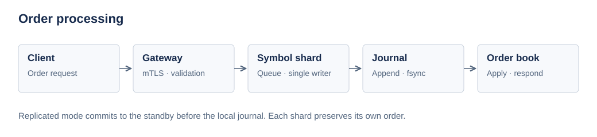

# AsterBook

C++20 order-matching engine for simulated exchanges, with durable recovery, mTLS replication, and performance benchmarks.



| Matching | Reliability | Tooling |
| --- | --- | --- |
| Price-time priority | Journal recovery and compaction | Benchmarks and fault tests |
| GTC, IOC, cancel, replace | Retry deduplication | Reference model and fuzzing |
| Single-writer symbol shards | mTLS replication; manual failover | Offline ITCH reconstruction |

## Quick start

Clone the repository and run:

```sh
git clone https://github.com/jas0nriverah/asterbook.git
cd asterbook
./start.sh
```

Checks dependencies → builds → runs tests → demonstrates mTLS. Missing dependencies get installation instructions. Check only: `./start.sh --check`.

## Documentation

| I want to… | Guide |
| --- | --- |
| Understand the engine | [Architecture](docs/architecture.md) |
| Send requests or read ITCH | [Protocol](docs/protocol.md) |
| Deploy, recover or fail over | [Operations](docs/operations.md) |
| Measure performance | [Benchmarking](docs/benchmarking.md) |
| Build and test changes | [Development](docs/development.md) |

[MIT license](LICENSE)
