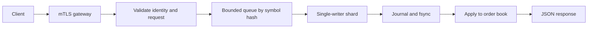
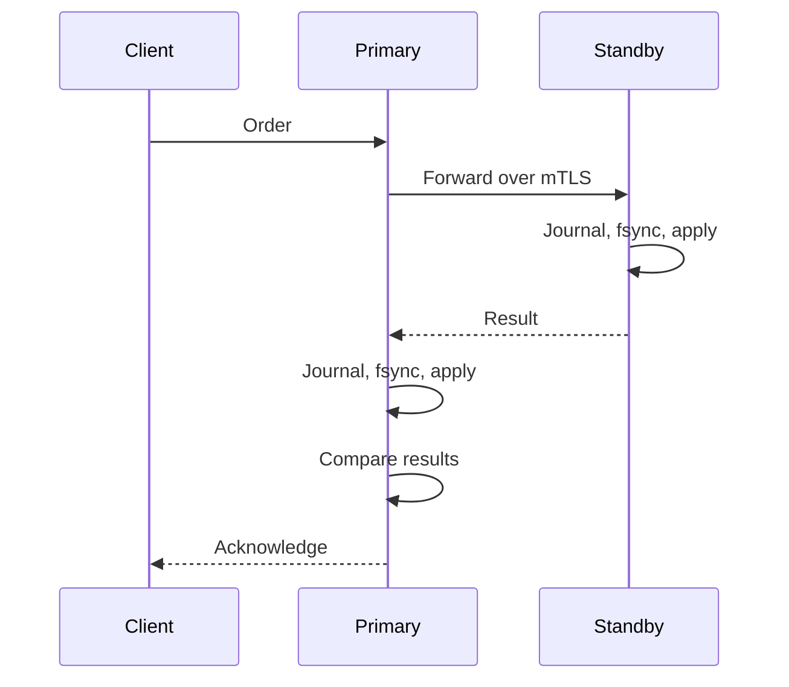
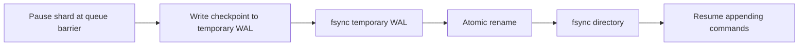

# Architecture

## Request path

Each shard owns its book, journal, queue and retry history.

| Rule | Behavior |
| --- | --- |
| Matching | Best price, then FIFO; trade at resting price |
| Replacement | Validate first; new order loses priority |
| Retry | Same client/request + payload returns saved result |
| History full | Reject new identities; never evict retry history |
| Multiple shards | Independent ordering; no cross-shard transaction or atomic snapshot |

## Replicated writes

| Condition | Action |
| --- | --- |
| Startup | Compare full checkpoint hashes, capacities and shard count |
| Missing/divergent standby | Refuse startup |
| Replication error or result mismatch | Stop primary; no silent standalone writes |
| Reply lost after standby commit | Retry exact request after fenced promotion; re-seed stale node |
| Transport | One TLS connection per command; five-second deadline |

Only the replication identity can write to the standby. [Failover is manual](operations.md#failover): no elections or online catch-up.

## WAL compaction

| Preserved | Changed |
| --- | --- |
| Orders, used IDs, retry results, capacities | Old command replay replaced by checkpoint |
| Exclusive ownership via separate lock file | Embedded checkpoint supersedes external snapshots |

Compaction may increase file size; it does not free history capacity. Recovery reads the old or new WAL and rejects corruption/incomplete data. Legacy WALs remain readable; **older binaries cannot read compacted WALs**.

Durability depends on storage honoring `fsync`. Checksums detect corruption, not tampering; process-crash tests do not prove power-loss durability.
