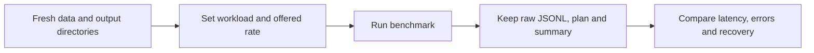

# Benchmarking

## Choose a measurement

| Tool | Measures |
| --- | --- |
| `build/release/core_bench` | Matching only |
| `build/release/durable_bench` | Matching + journal sync |
| `bench/open_loop.py` | Scheduled requests against an existing server |
| `bench/capacity.py` | Disposable standalone TLS server: latency, outcomes, resources, recovery |



```sh
python3 tools/dev_certs.py /tmp/bench-certs
python3 bench/capacity.py --server build/release/asterbook \
  --data-dir /tmp/new-bench-data --output /tmp/new-bench-results \
  --cert-dir /tmp/bench-certs --rate 100 --seconds 60 --clients 8 --shards 2
```

| Option | Purpose |
| --- | --- |
| `--hot` | Concentrate load on one shard |
| `--fault term` or `--fault kill`, with `--fault-at SECONDS` | Inject process failure |
| `--min-free-disk-bytes` | Disk floor; default 10 GiB |
| `./start.sh --enable-google-benchmark` | Enable optional Google Benchmark |
| `python3 tools/slo_report.py --help` | Aggregate request/probe results |

Default experiment targets: **p99 ≤10 ms**, **99.9% correct within 50 ms**, **99% accepted offered rate**, **recovery ≤30 s**. These are configurable targets, not guarantees or CI performance gates. Count failures and generator drops.

Report host, storage, build, allocator, batch size, workload and duration. Compare core, standalone and replicated results separately; use an external workload for a deployed replica pair. The mixed workload includes new, replace, cancel, matching IOC and expiring IOC.

Linux samples `/proc`; macOS uses `ps` and marks unsupported counters null. Process-kill tests do not measure physical power-loss durability.
