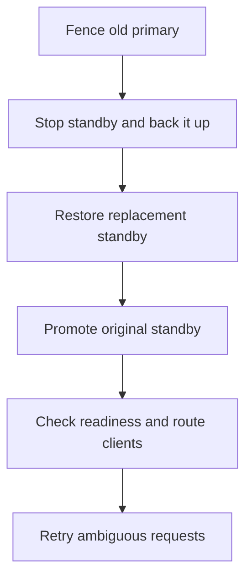

# Operations

## Deploy


```sh
asterbook validate-config FILE
python3 scripts/package-release.py --version VERSION --build-dir build/release --output dist
python3 scripts/release.py --root /opt/asterbook install ARCHIVE.tar.gz --sha256 TRUSTED_SHA256
```

Use a compatible Linux build, persistent local storage and an unprivileged service account. Start from [server.conf.example](../deploy/server.conf.example) and [asterbook.service](../deploy/asterbook.service). Stop with SIGTERM; wait for exit.

| Item | Requirement |
| --- | --- |
| Code/config/CA | Protected from service-account writes |
| Data | Owned by service account |
| TLS keys | Regular files; owner-only permissions |
| Client access | Certificate common name identifies client; admin policy gates maintenance |
| Certificate rotation | Validate files, restart; use current CA-signed CRL or rotate CA |
| Development mode | `--insecure-local` stays on loopback; never proxy it externally |
| Upgrade interrupted | Run installer `status`; `rollback` changes binaries, not data |
| Package verification | Obtain checksum independently; checksum is not a signature |

## Replication setup

Both nodes need identical initial data, shard count and capacities, plus normal server TLS credentials. Seed stopped nodes from verified backups. Start the standby first.

| Standby config | Primary config |
| --- | --- |
| `standby-identity=replicator` | Options below |

```ini
replica-host=192.0.2.20
replica-port=9000
replica-name=standby.example.internal
replica-cert=/etc/asterbook/replicator.crt
replica-key=/etc/asterbook/replicator.key
replica-ca=/etc/asterbook/standby-ca.crt
```

Use a dedicated client-auth certificate with CN `replicator`; keep its key on the primary. `replica-host` is IPv4; `replica-name` must match the standby certificate. Startup rejects mismatched state or roles.

## Failover



| Step | Required action |
| --- | --- |
| Fence | Stop and prevent restart, or isolate/power off old primary |
| Promote | Start replacement first; remove `standby-identity` on promoted node and set its `replica-*` options |
| Retry | Reuse original request IDs and payloads |
| Rejoin | Re-seed old primary before reuse |

**A timeout is not fencing. Never run two writable primaries.** For deliberate single-node recovery, omit `replica-*` on the promoted node; new writes then have one durable copy.

## Maintenance

| Task | Procedure |
| --- | --- |
| Compact | Send authenticated `V1 COMPACT`; blocks each shard while writing |
| Space | Keep room for both WAL copies; history capacity is unchanged |
| Compatibility | Keep pre-upgrade backup; old binaries cannot read compacted WALs |
| Backup | Stop service → verify hashes/replay → copy off-host |
| Restore | Restore to new directory → verify → start → test retries |

```sh
python3 tools/recovery.py backup --data-dir DATA --root BACKUPS --keep 7 --verifier build/release/recovery_verify
python3 tools/recovery.py restore --backup BACKUPS/backup-NAME --destination NEW_DATA --verifier build/release/recovery_verify
```

Never delete journals/locks manually. Compact nodes independently. The example [backup timer](../deploy/asterbook-backup.timer) and [script](../deploy/backup.sh) stop/restart the service; configure and monitor the backup mount.

## Monitoring


Configure [exporter service](../deploy/asterbook-monitor.service), [scraping](../deploy/prometheus-scrape.yml) and [alerts](../deploy/alerts.yml). Keep the exporter HTTP listener private.

| Signal | Meaning |
| --- | --- |
| `/healthz` | Exporter health |
| `/readyz` | Upstream local WAL sync; check standby separately |
| `/metrics` | Returns 503 if collection fails |
| Histograms | Log2 nanosecond bins; service time excludes network |
| Default bounds | 128 connections; 4 KiB requests; 32 MiB responses; 256 queued commands |
| Per-shard capacity | 10,000 live orders; 1,000,000 history entries; no history eviction |

Track free disk and history capacity before exhaustion.
