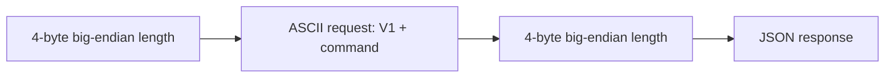
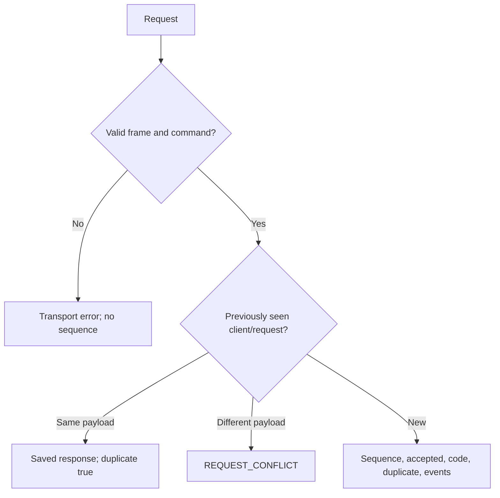
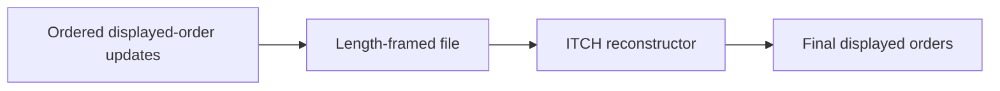

# Protocol

## Wire format



| Field | Constraint |
| --- | --- |
| Request body | Up to 4096 bytes; single spaces between tokens |
| Identifiers | 1–64 ASCII letters, digits, `_`, `-`, `.` |
| Numbers | Positive signed-64-bit decimal; no leading zeroes |
| TCP reads | May contain partial or multiple frames |

## Commands

```text
V1 NEW client request symbol order_id BUY|SELL GTC|IOC price quantity
V1 CANCEL client request symbol order_id
V1 REPLACE client request symbol order_id new_id price quantity
```

| Order | Behavior |
| --- | --- |
| NEW | Best price then FIFO; trade at resting price |
| GTC / IOC | Rest remainder / expire remainder |
| CANCEL | Requires owner and live order |
| REPLACE | Validate before removal; loses priority; GTC |
| IDs | Never reused within shard; prefer globally unique IDs |

Administrative commands require an authorized mTLS identity; insecure-local permits local clients.

| Command | Result |
| --- | --- |
| `V1 STATE` | Book state |
| `V1 METRICS` | Gateway counters |
| `V1 CHECKPOINT` | Legacy checkpoint |
| `V1 COMPACT` | Atomically replace each shard WAL with embedded checkpoint |
| `V1 DIGEST` | Full checkpoint hash and standby role |
| `V1 READY` | Local journal sync check; not replica health |

## Responses and retries



| Case | Client behavior |
| --- | --- |
| Disconnect/overload | Result may be ambiguous; retry exact identity and payload |
| History full | New requests rejected; history is never evicted |
| Events | Ordered CANCEL, TRADE, REST, EXPIRE |
| Multiple shards | Responses wrap `result` with `shard`; sequence and retry scope are per shard |
| Aggregated admin state | `atomic:false`; no single cross-shard snapshot |

## Offline ITCH



```sh
build/release/asterbook_itch FILE
python3 reference/itch.py FILE
build/release/asterbook_itch --sequenced FILE
```

| Item | Supported behavior |
| --- | --- |
| Messages | A/F add, E/C execution, X cancel, D delete, U replace |
| Framing | 2-byte big-endian length + ITCH 5.0 payload; not SoupBinTCP/MoldUDP64 |
| Sequenced mode | Adds 8-byte big-endian sequence before each frame |
| Prices | 1/10,000 dollars |
| Executions | Reduce referenced order; never enter matching engine |
| Input errors | Unsupported messages, invalid lengths/references/reductions/locates stop processing |
| Sequence errors | Gap, duplicate or overflow poisons session until `reset()`; no gap recovery |
| Native limits | Default 1M live / 2M seen references; constructor-configurable |
| Native state | Validation errors preserve state; discard after allocation failure |
| Text fields | Stock/attribution must be printable ASCII |

Filter real feeds upstream. No feed transport, symbol directory, trading actions, trade statistics or broken-trade handling. Output is not a complete market picture. See [ITCH 5.0 specification](https://nasdaqtrader.com/content/technicalsupport/specifications/dataproducts/NQTVITCHSpecification.pdf), §§1.3–1.4.
